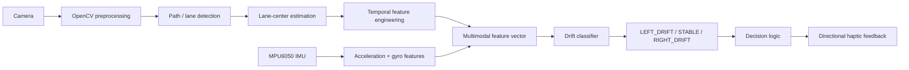

# GuideStride

> **Status: Work in Progress** — software perception prototype is functional; real-world data collection, IMU fusion, model validation, and hardware haptics are still being integrated.

GuideStride is a wearable AI-assisted running guidance system for blind and visually impaired runners. The project combines **computer vision, inertial sensing, machine learning, edge computing, and haptic feedback** to estimate lateral position and provide real-time corrective guidance.

## Demo

Current software demo: https://youtu.be/rgdRVYkK_vU

The demo shows the present perception pipeline on prerecorded video: lane/path detection, lane-center estimation, center-error tracking, drift-state estimation, and simulated directional guidance.

## Current pipeline



## What is implemented now

- OpenCV video pipeline for lane/path-boundary detection.
- Lane-center and normalized center-error estimation.
- Temporal smoothing and lateral-error trend features.
- Three-state software drift logic: `LEFT_DRIFT`, `STABLE`, `RIGHT_DRIFT`.
- Simulated directional haptic guidance in the demo overlay.
- Frame-by-frame CSV logging for reproducible analysis.
- Raspberry Pi data-collection script for synchronized video + MPU6050 IMU capture.
- Random Forest training/evaluation pipeline prepared for labeled multimodal data.
- Unit tests and GitHub Actions CI.

## Engineering targets

These are **development targets, not final measured results**:

| Metric | Target |
|---|---:|
| Labeled samples | 10,000+ |
| Engineered features | 10+ |
| Drift classes | 3 |
| Classification accuracy | 85%+ |
| Vision throughput | 20–30 FPS |
| End-to-end response latency | under 150 ms |

## Tech stack

**Python · OpenCV · NumPy · pandas · scikit-learn · Random Forest · Raspberry Pi 4 · MPU6050 · I2C · GPIO · pytest · GitHub Actions**

## Repository structure

```text
GuideStride/
├── src/guidestride/
│   ├── lane_detection.py      # OpenCV path/lane detection + center estimation
│   ├── drift.py               # Temporal drift state + guidance logic
│   ├── features.py            # Vision/IMU feature construction
│   ├── imu.py                 # MPU6050 I2C interface
│   └── visualization.py       # Recruiter-friendly demo overlay
├── scripts/
│   ├── generate_demo_video.py # Synthetic track generator for repeatable testing
│   ├── run_guidestride.py     # Run the current perception pipeline on video
│   ├── collect_session.py     # Raspberry Pi video + IMU data collection
│   └── train_random_forest.py # Train/evaluate the planned drift classifier
├── tests/                     # Unit tests
├── docs/                      # Architecture, data schema, hardware, roadmap
├── data/                      # Dataset instructions only; raw data is gitignored
├── outputs/                   # Generated logs/videos are gitignored
├── models/                    # Trained models are gitignored
└── .github/workflows/ci.yml   # Automated test workflow
```

## Quick start

### 1. Create an environment

```bash
python3 -m venv .venv
source .venv/bin/activate
pip install -r requirements.txt
```

### 2. Generate a reproducible demo video

```bash
python scripts/generate_demo_video.py
```

### 3. Run GuideStride

```bash
python scripts/run_guidestride.py --video data/demo/demo_track.mp4 --save-video
```

Expected generated artifacts:

```text
outputs/run_log.csv
outputs/guidestride_demo.mp4
```

### 4. Run tests

```bash
pytest
```

## Data collection on Raspberry Pi

Install the optional hardware dependency:

```bash
pip install -r requirements-hardware.txt
```

Example collection run:

```bash
python scripts/collect_session.py --duration 60 --camera-index 0
```

Each session is stored as:

```text
dataset/raw/<session_id>/
├── video.mp4
├── imu.csv
├── frames.csv
└── metadata.json
```

See [`docs/DATA_SCHEMA.md`](docs/DATA_SCHEMA.md) and [`docs/HARDWARE.md`](docs/HARDWARE.md).

## Machine-learning stage

The planned classifier combines spatial, temporal, and IMU-derived features such as:

- normalized center offset
- smoothed center offset
- lateral error slope
- lane-detection confidence
- accelerometer `ax`, `ay`, `az`
- gyroscope `gx`, `gy`, `gz`

Once labeled data is available:

```bash
python scripts/train_random_forest.py --csv path/to/labeled_features.csv
```

The training script performs a stratified split, Random Forest hyperparameter search, classification metrics, confusion-matrix export, and model serialization.

## Current limitations

- Current visual demo uses prerecorded/synthetic video rather than a validated outdoor running dataset.
- Current drift state in the demo is heuristic; the Random Forest stage is prepared but requires real labeled multimodal data for meaningful validation.
- IMU + camera synchronization must still be tested extensively on-device.
- Physical vibration-motor feedback is not yet validated with runners.
- Accuracy, FPS, and latency values above are targets until measured under defined real-world conditions.

## Roadmap

1. Complete repeated Raspberry Pi collection sessions.
2. Build and quality-check a 10,000+ sample labeled dataset.
3. Engineer and ablate multimodal features.
4. Train and tune the Random Forest baseline.
5. Compare vision-only vs. vision + IMU performance.
6. Integrate real GPIO-controlled vibration motors.
7. Measure FPS, latency, confusion matrix, and failure cases.
8. Conduct controlled user-centered validation with appropriate safety procedures.

## Why this project

GuideStride is intentionally being developed as an **end-to-end engineering system**, not only an ML notebook: sensing, data collection, feature engineering, classification, edge deployment, evaluation, and human-facing feedback are designed as one pipeline.

---

**Author:** George Lawendy  
**Project stage:** Active development
